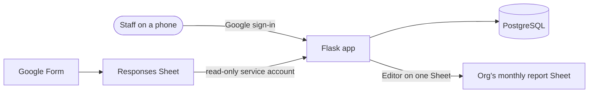

# FOCUS Houston Metrics Tracker

**Christopher Zarco · Solutions Engineer (volunteer), FOCUS Houston · August 2026 – present**

A web app that replaced a nonprofit's hand-built spreadsheets with one system
for recording what it gives to the families it serves, and for producing the
monthly report its national office asks for.

> This is a public copy of a private production app. People's names are
> removed, the item catalog uses **made-up prices**, and internal runbooks
> and client documents are kept private.

---

## The problem

FOCUS Houston supports mothers and their children with diapers, formula,
clothing, classes and case management. Every month it reports its numbers to
FOCUS North America.

Before this app, staff typed every distribution into Google Sheets by hand:

- **The totals were wrong.** Spreadsheet formulas had broken (`#REF!`, a total
  that skipped a column), and 4 of 9 months didn't reconcile.
- **Reporting took hours.** Each month's report was rebuilt by hand.
- **Privacy was at risk.** Free-text notes sat next to the numbers.

## What I built

| For | What it does |
|---|---|
| **Staff** | Count a distribution on a phone, review it, approve it. A review queue catches anything with no price or category. |
| **Directors** | A Totals page with every metric the national template asks for, for any month, year or date range. |
| **Reporting** | One click fills the organization's **own Google Sheet** in its exact format: a new tab per period, the app's totals, never a formula. |
| **Program health** | Client check-ins from a Google Form, an intake timer, and retention, engagement and turnover rates. |
| **Admins** | Roles, an audit log of every change, backups, and import/export of history. |

## Impact

- **Reconciled 9 months of spreadsheets** (Jan–Sep 2026): found and fixed the
  errors behind the broken totals, and corrected Non-Food Gifts-in-Kind.
- **About $40K of in-kind goods** tracked for Jan–Sep 2026.
- **180+ sessions and 22,000+ diapers** imported and checked against the
  original sheets.
- **The monthly report goes from hours to one click.**
- **750+ automated tests.**

## How it works



- **One source of truth.** Every number on screen, in the CSVs and in the
  Google Sheet comes from the same functions, so they can't disagree.
- **Values frozen at approval.** A price change later never rewrites history;
  corrections go through the audit log.
- **No names stored.** A client is a card number with a check digit, never a
  name.

## Security

- **Deny by default.** Every page needs Google sign-in from an allowlisted
  account. Staff can reach only an explicit list of pages, and the server
  enforces it, not just the links.
- **CSRF tokens, rate limits, security headers** (CSP, HSTS) and session
  expiry.
- **Least privilege for Google:** read-only access to the form's Sheet, and
  Editor on one report Sheet only.
- **Safe exports:** text that looks like a spreadsheet formula is written as
  text (CSV-injection defense).
- **Secrets never in code:** environment variables only. Dependencies are
  pinned with hashes and checked with `bandit` and `pip-audit`.

## Tech stack

Python 3.14 · Flask 3 · SQLAlchemy 2 · Alembic · PostgreSQL 18 · Authlib
(Google OAuth) · Google Sheets API · Flask-Limiter · gunicorn · Docker ·
Render (infrastructure as code) · pytest

## Run it locally

```bash
docker compose up -d                       # PostgreSQL on 127.0.0.1:5433
python -m venv .venv && source .venv/bin/activate
pip install -r requirements.txt -r requirements-dev.txt
flask --app run db upgrade                 # create the schema
python seed.py                             # load the sample catalog
python run.py                              # http://127.0.0.1:5001
pytest                                     # the test suite
```

Signing in needs a Google OAuth client (`GOOGLE_CLIENT_ID`,
`GOOGLE_CLIENT_SECRET`); see `.env.example`.

## License

MIT
